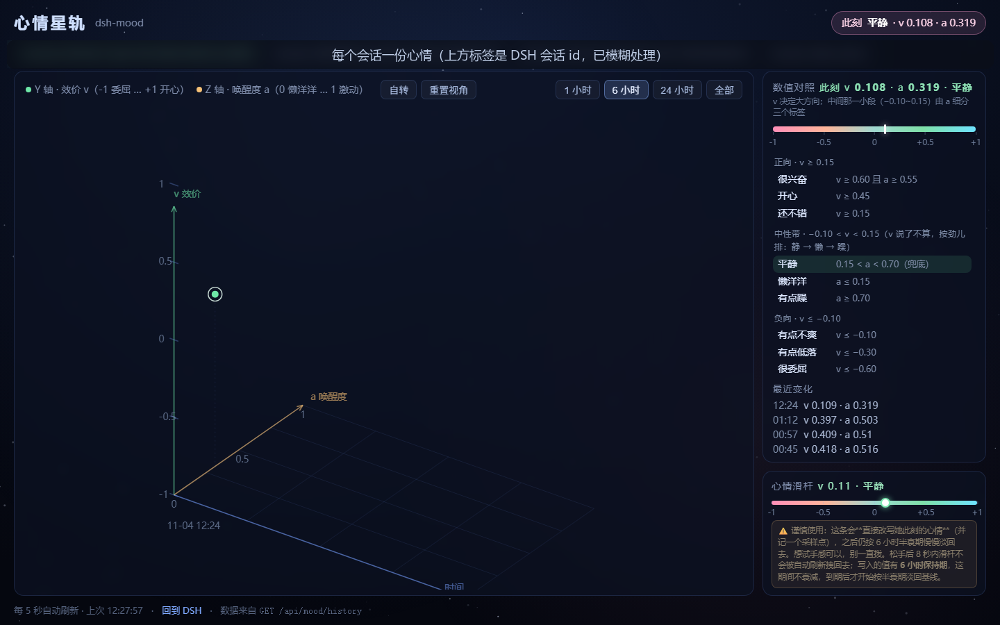

# dsh-mood-chart · 心情星轨



把心情画成一条**三维曲线**的 DSH 插件：X = 时间、Y = 效价 v、Z = 唤醒度 a，能自由转、能缩放、
还带九档对照表和一条手拨滑杆。

它是 `dsh-mood` 的**纯前端伴侣**：自己不存任何状态，页面直接调 `dsh-mood` 提供的
`/mood-chart/api/state` 与 `/mood-chart/api/set`。两者解耦 —— 图表想升级不会碰到心情内核，
不装 `dsh-mood` 时页面照常打开，只会提示「读不到心情数据」。

## 它长什么样

```
        Y = 效价 v (+1 开心)
        ↑
        │      ╭──╮   ← 曲线（正段绿、负段粉）
        │   ╭──╯  ╰─╮
        │ ╭─╯        ╰╮
   ─────┼────────────┼────→ X = 时间
       ╱              ╲
      ╱  地面网格（a 方向）
     ↙  Z = 唤醒度 a
```

- 每个采样点往地面拉一条淡虚线（判深度），曲线按 v 分段上色，最新点白圈高亮
- **拖动**自由旋转（偏航 + 俯角）、**滚轮**缩放、**双击**复位、头部「自转」按钮
- 右栏「数值对照」：渐变条（-1 / -0.5 / 0 / +0.5 / +1 刻度）+ 九档分三组（正向 / 中性带 / 负向）+ 当前档高亮
- 底部「心情滑杆」：拖动预览、松手写入（带 6 小时保持期），下面一行谨慎使用提示

## 下载

- 直接下载打包好的插件：[`dist/dsh-mood-chart-0.1.0.zip`](dist/dsh-mood-chart-0.1.0.zip)
- 需要先装 [`dsh-mood`](https://github.com/leesingx/dsh-mood)（数据来源）

## 安装

```bash
node install.mjs                 # 自动探测 profile（优先 desktop）
node install.mjs --profile web   # 指定
node install.mjs --link          # 开发模式
```

装完重启 DSH，然后打开 `http://127.0.0.1:<DSH端口>/mood-star`。

## 前置

需要 `dsh-mood` 提供数据与写入接口：

```
GET  /mood-chart/api/state      → { ok, keys, moods }
POST /mood-chart/api/set        → { key, v, a?, holdHours? }
```

没装 `dsh-mood` 时页面会显示「读不到心情数据：…」，其它功能不受影响。

## 和 dsh-mood 的分工

| 插件 | 负责 |
| --- | --- |
| `dsh-mood` | 心情内核：状态、衰减、关键词感知、提示注入、`mood_get`/`mood_set`、数据接口 |
| `dsh-mood-chart`（本插件） | 只负责画：`/mood-star` 一张页面 |

## 许可

MIT。
